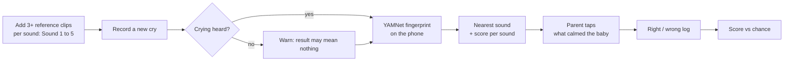
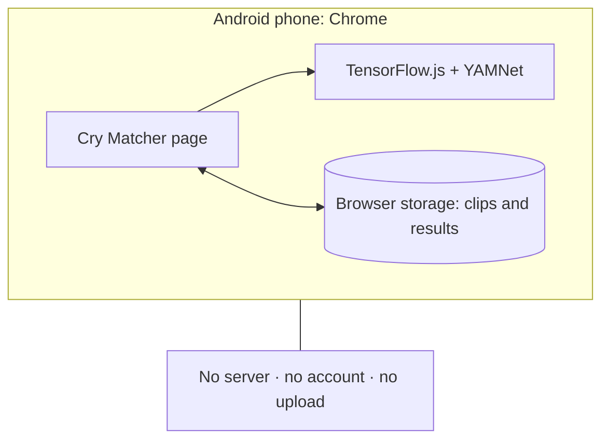

# Cry Matcher

> A short proof of concept. Experimental. Not medical advice.

## The problem

When a baby cries, parents guess: hungry, tired, needs a burp? Some parents believe each need has its own sound. I was curious whether a phone could hear that difference, and, more importantly, whether we can **measure** if it helps instead of trusting it.

## The bet

- **Hypothesis:** with a parent's own reference clips, the closest-sound match beats chance on real cries.
- **Success metric:** share of matches marked right in the app, compared with the chance level for the sounds in play.
- **Kill signal:** after a fair number of answered results, the score stays near chance.

## Approach and options considered

| Option | Verdict |
| --- | --- |
| Train a cry classifier from scratch | Rejected. Needs large labeled data, and open cry labels are mostly parents' guesses. |
| Cloud audio AI or API | Rejected. Baby audio leaves the phone, needs an account and a network. |
| Large pretrained audio models (e.g. transformer-based) | Rejected for v1. Too heavy to run well in a phone browser. |
| **Small pretrained model, on device** | **Chosen.** YAMNet (Google): trained on AudioSet, which includes a "baby cry" class. Runs in the browser with TensorFlow.js. No training data needed. |

Matching is deliberately simple: average the sound "fingerprints" of your clips per sound, then pick the nearest one. Simple first, so the log can show whether anything more is worth building.

## How it works

## Features

- Five neutral sounds (Sound 1 to Sound 5). Rename each to what you think it means.
- Record in the app or pick a recording.
- Closest match with a score per sound and a low-confidence warning.
- One tap to log what actually worked; "Not sure" does not count.
- Score: right of total, per sound, next to chance.
- Self-check: how well your reference clips separate.
- Backup and restore in one file; results as CSV.
- Works offline after the first visit. Add to Home screen.

## Quick start (Android)

1. Open the website link (in the About box) in Chrome and allow the microphone.
2. Add 3 or more clips to at least 2 sounds.
3. When the baby cries, tap **Record**.
4. When you know what worked, tap it. Watch the score.

## Privacy

- All processing runs on the phone. No audio or result is sent anywhere.
- Data stays in Chrome's storage on that phone. Export a backup before you clear site data.
- This repo has no recordings.

## Accuracy, honestly

- **Unproven.** On an open crowd-sourced cry set labeled with parents' guesses, this method did not beat chance.
- That is why the app logs every result. Early scores swing a lot; judge after many answers.

## Next iterations

- Learn from feedback: add confirmed clips to the references automatically.
- Per-baby reference sets and a confusion table (said vs. true).
- If the signal is real: a small few-shot classifier on top of the fingerprints, then fine-tuning.

## Built with

TensorFlow.js, YAMNet, plain HTML and JavaScript, GitHub Pages. No build step, no backend. Prototyped with an AI coding assistant.

## License

My code: MIT (see `LICENSE`). YAMNet weights and TensorFlow.js: Apache 2.0, Google LLC (see `THIRD_PARTY_NOTICES.md` and `LICENSE-Apache-2.0.txt`).

## Author

Built by Prashant. More of my work: [prashantrana.xyz](https://prashantrana.xyz/)
